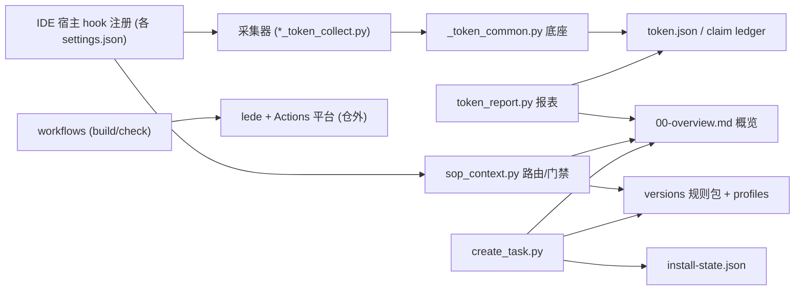

# 仓内模块依赖矩阵与影响面图谱

刻画本仓模块间真实耦合边：核心是「概览文件 `00-overview.md` 的 Branch/Phase 字段」与「`install-state.json` 的 revision」两个文本契约枢纽——它们以数据形态串起路由、采集、报表三条链。本仓为单仓工作区，无跨仓依赖边。

## 1. 模块依赖拓扑图

## 2. 模块×模块真实调用边明细

| 调用方模块（Caller） | 被调方模块（Callee） | 耦合介质 | 契约符号 | 证据锚点（`路径:行号`） |
|---|---|---|---|---|
| 各客户端 settings/hooks.json | `sop_context.py --hook` | 进程调用（内联 Python 定位仓库根） | `--hook --client <c> --event <e>` | `.claude/settings.json:18`、`.codebuddy/settings.json:19`、`.codex/hooks.json:16`、`.cursor/hooks.json:10` |
| 各客户端 settings | `*_token_collect.py` | 进程调用（stdin JSON 载荷） | Stop/UserPromptSubmit 等事件 | `.claude/settings.json:8`、`.codebuddy/settings.json:8`、`.codex/hooks.json:8`、`.cursor/hooks.json:6` |
| 四采集器 | `_token_common.py` | 同目录 import（`from _token_common import ...`） | `sync_task_store`/`normalize_usage` 等 | `.claude/hooks/claude_token_collect.py:23-35`、`.codebuddy/hooks/stop_token_collect.py:43-56` |
| `sop_context.py` | `create_task.py` | 跨文件 import | `method_configured` | `.wally/scripts/sop_context.py:8` |
| `sop_context.py` | `.wally/core/entry.md` 等文档 | 文件读取（`read`） | 路由文档包 | `.wally/scripts/sop_context.py:88`、`sop_context.py:144-151` |
| `sop_context.py` | `.wally/core/scope.md`、`.wally/profiles/project.md`、`.wally/rules/README.md`、`.wally/versions/3f84e7245abcc75d/core/workflow.md` | 文件读取（hook 态注入 scope；路由态装载 Profile 与规则） | 分类规则 / 项目策略 / 绑定流程 | `.wally/scripts/sop_context.py:437-439`、`sop_context.py:152-165` |
| 六客户端 skills 目录 | `.agents/skills/clarify/SKILL.md` 等正本 | 目录软链（`../../.agents/skills/<name>`） | 技能分发 | 详见 [agent-integration-layer](agent-integration-layer.md) 第 1 节分发拓扑表 |
| `create_task.py` | `install-state.json` / `versions` 模板 / `profiles/project.md` | 文件读取 | `revision`/`steps`/模板展开 | `.wally/scripts/create_task.py:83-109` |
| `token_report.py` | `codex_token_collect.py` | 子进程调用 | `--refresh-task <dir>` | `.claude/scripts/token_report.py:406-409` |
| `token_report.py` | `token.json` / 概览标记对 | 文件读写 | `TOKEN_USAGE_START/END` | `.claude/scripts/token_report.py:457-472` |
| 构建工作流 | lede 仓 / Actions Action | git clone / `uses:` | `REPO_URL`、各 `with:` | `.github/workflows/build-openwrt.yml:61`、`build-openwrt.yml:168` |
| 巡检工作流 | lede 仓 / cache / dispatch | git clone / `uses:` | `commitHash`、`event-type` | `.github/workflows/update-checker.yml:32`、`update-checker.yml:49` |
| 巡检工作流 | 构建工作流 | `repository_dispatch` 事件（跨文件字面量桥） | `Source Code Update` | `.github/workflows/update-checker.yml:52` → `build-openwrt.yml:14` |

## 3. 变更爆炸半径与架构审计（Blast-Radius Audit）

- **高扇入核心底座（改契约须全仓搜索并跑四 CLI 冒烟）**：
  1. `00-overview.md` 的 Meta 发现字段（`Branch`/`SOP Rules`/`Phase`）：被 4 个模块消费——`sop_context.py:19-21`（路由）、`create_task.py:98-104`（独占校验）、`_token_common.py:280`（任务定位）、`token_report.py:100`（报表定位）。
  2. `_token_common.py` store 契约：被 4 客户端采集器 + 报表（`token_report.py:109-121`）消费；四处副本须 MD5 一致。
  3. `install-state.json` 的 `revision`：决定 `create_task.py:91` 规则根、任务 SOP Rules 路径、`sop_context.py:131-132` 校验正则。
  4. `AGENTS.md` 入口段：被 `CLAUDE.md`/`CODEBUDDY.md` 软链与 `.github/copilot-instructions.md:1-51` 副本消费。
- **循环依赖与延迟导入记录**：未发现（Python 模块单向依赖：采集器 → 底座；路由 → 建任务的 `method_configured` 单函数 import，`.wally/scripts/sop_context.py:8`）。
- **跨进程边界约定**：
  - IDE 宿主 → hook 脚本：stdin JSON + 超时 3s（[agent-integration-layer](agent-integration-layer.md) 第 2 节）；
  - 巡检 → 构建：`repository_dispatch` 字符串桥（两端锚点见第 2 节末行）；
  - 报表 → Codex 采集器：`sys.executable` 子进程（`token_report.py:406-409`）。

## 4. 跨仓依赖矩阵（`repo_deps` · 单仓工作区声明）

本仓为单仓模式，`repo_deps = []`；外部系统依赖（lede / passwall / GitHub 平台 / transfer / tmate / wally-open-cli 服务）以出向调用契约形式登记于 [`integrations/index.md`](../integrations/index.md)，均为仓外黑盒（[认知边界](../operations/boundary.md) 第 2 节）。跨仓环检测结论：不适用（单仓）。

## 5. 共变耦合与修改清单（Agent Co-Change Playbook）

- 改第 2 节任一耦合边的契约符号：同步对端模块与本表；高扇入底座（第 3 节四项）按「全仓搜索消费点 → 四 CLI 冒烟 → 文档同步」三步执行。
- 新增客户端接入：第 1 节拓扑图、第 2 节 settings 行、[agent-integration-layer](agent-integration-layer.md) 矩阵、`sop_context.py:399` `--client` 枚举四处联动。
- 删除/重命名 hook 脚本：先删注册（四 settings），再删脚本，最后核对本表与 [token-collectors](token-collectors.md) 差异矩阵，避免注册悬空导致 hook 失败静默（`.wally/scripts/sop_context.py:466-472` 吞异常特性会掩盖断裂）。
