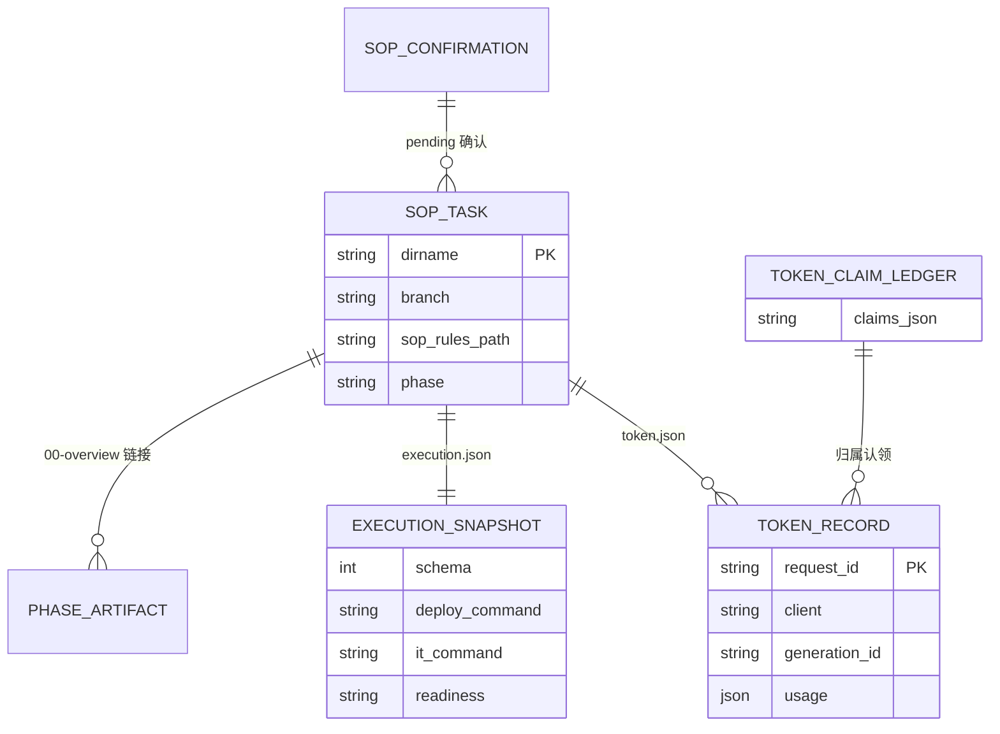

# 核心领域与数据模型总览

本仓没有数据库：全部领域状态以「文件树 + JSON + Markdown 表格字段」形态存在，分两个聚合——任务工件聚合（SOP 流程的状态实体）与用量台账聚合（采集流程的状态实体）。存储介质边界：仓内可提交文件 / 仓内 gitignore 文件 / 仓库外用户主目录文件三层，各实体的读写方与原子性机制见分页。

## 1. 实体与存储关系图

## 2. 聚合实体速查与权威分页

| 聚合实体 | 权威存储位置 | 核心写入方（Writer） | 读取消费方（Reader） | 专页 |
|---|---|---|---|---|
| 任务工件（概览/阶段文件/执行快照） | `.wally/plans/<task>/`（当前仓内尚无实例目录） | `create_task.py`（脚手架）、Agent 各阶段填写 | `sop_context.py` 路由、采集器定位、`token_report.py` | [`sop-task-artifacts.md`](sop-task-artifacts.md) |
| 用量台账（任务台账/认领账本/确认状态） | `.wally/plans/<task>/token.json`、`~/.wally/wally-init/token_claims.json`、`.wally/local/sop-confirmations.json` | 四客户端采集器、`sop_context.py` 确认流 | `token_report.py`、`sop_context.py` | [`token-ledger.md`](token-ledger.md) |
| 安装账本（元实体） | `.wally/install-state.json` | wally-init 安装/升级流程（仓外工具） | `create_task.py` 准入校验 | 概览见 [sop-task-artifacts.md](sop-task-artifacts.md) 第 4 节 |
| 构建输入（静态资产） | `.config`、`diy-part1.sh`、`diy-part2.sh` | 人工编辑（属 SOP 开发改动范围） | 构建工作流步骤 | 契约见 [configuration](../../contracts/configuration.md) 与 [openwrt-build-pipeline](../../architecture/openwrt-build-pipeline.md) |

## 3. 全库存储介质与读写归属矩阵

| 存储载体 | 精确路径模板 | 权威写入方（`路径:行号`） | 读取消费方（`路径:行号`） | 并发与原子性机制 |
|---|---|---|---|---|
| 任务目录（仓内，可提交） | `.wally/plans/YYYY-MM-DD_title/` | `create`（`.wally/scripts/create_task.py:148-159`） | `route`（`.wally/scripts/sop_context.py:97-104`） | staging 临时目录 + `rename` 原子落盘 |
| 原始用量台账（gitignore） | `.wally/plans/<task>/token.json` | `sync_task_store`（`.claude/hooks/_token_common.py:639-666`） | `load_requests`（`.claude/scripts/token_report.py:109-121`） | flock + 临时文件 `os.replace`（`_token_common.py:396-449`） |
| 认领账本（仓库外） | `~/.wally/wally-init/token_claims.json` | `record_claims`（`_token_common.py:571-602`） | `foreign_ids`（`_token_common.py:613-636`） | flock + LRU 裁剪 `MAX_CLAIMS=5000` |
| 确认状态（gitignore） | `.wally/local/sop-confirmations.json` | `save_confirmation_state`（`sop_context.py:311-322`） | `confirmation_state`（`sop_context.py:293-308`） | 临时文件 + `replace` 原子写 |
| 安装账本（仓内，可提交） | `.wally/install-state.json` | wally-init（仓外工具） | `create_task.py:83-90`、`sop_context.py:116-119` | 一次性全量 JSON 写 |
| 执行方法配置（仓内，可提交） | `.wally/config.json` | 人工/客户方填写 | `execution_config`（`create_task.py:26-53`） | 只读快照进任务 `execution.json` |

## 4. 字段增删改共变清单（Schema Change Playbook）

- 任务工件字段：概览 Meta 表字段（`Branch`、`SOP Rules`、`Phase`）是三处正则消费的发现字段——改动须同步 `.wally/scripts/sop_context.py:19-21`、`.wally/scripts/create_task.py:102`、`.claude/hooks/_token_common.py:280` 与 `.claude/scripts/token_report.py:100`（详见 [sop-task-artifacts.md](sop-task-artifacts.md)）。
- 台账字段：`usage` 七键结构（`_token_common.py:37-42`）增删须同步采集器归一化（`normalize_usage`）与报表合计列（`token_report.py:282-290`）（详见 [token-ledger.md](token-ledger.md)）。
- 台账与概览的联动：`patch_overview` 依赖 `TOKEN_USAGE_START/END` 标记对存在于任务模板（`.wally/versions/3f84e7245abcc75d/plans-template/00-overview.md:51-53`）——模板改版必须保留该标记对，否则所有旧任务的报表渲染失败。
