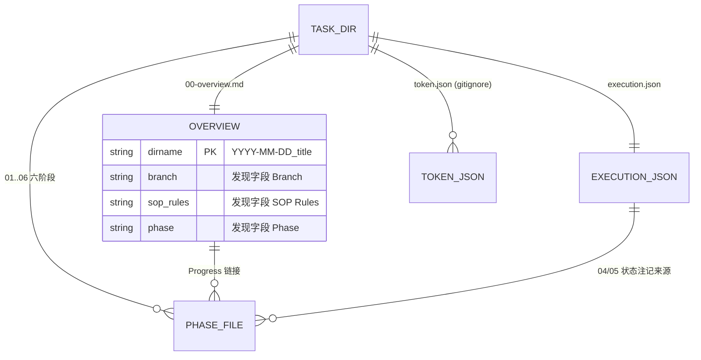

# 聚合实体：SOP 任务工件树（`.wally/plans/<task>/`）

任务工件是 SOP 流程的唯一状态实体：一个任务目录承载概览（进度事实源）、六个阶段文件、执行方法快照与用量台账。当前工作树中 `.wally/plans/` 目录尚不存在——首个任务由 `create_task.py` 首次运行时创建，本文全部结构取自模板与创建代码的确定性行为。

## 1. 实体与存储关系图

## 2. 精确字段字典（Exact Schema Dictionary）

### 2.1 任务目录名（主键）

| 字段 | 类型 | 必填 / 默认值 | 约束 | 定义/校验锚点 |
|---|---|---|---|---|
| 目录名 | `str` | 必填（用户给定） | 正则 `\d{4}-\d{2}-\d{2}_[\w.-]+`，日期段须可解析，不得以 `.` 结尾、不得含路径分隔符 | `.wally/scripts/create_task.py:71-73` |
| 绑定分支 | `str` | 必填（`--branch`） | 非 `main/master/HEAD`，不含 `` ` ``、`|`、换行；全任务目录内唯一 | `.wally/scripts/create_task.py:74`、`create_task.py:98-104` |

### 2.2 `00-overview.md`（概览，模板 `.wally/versions/3f84e7245abcc75d/plans-template/00-overview.md:1-65`）

| 字段 / 键路径 | 类型 | 必填 / 默认值 | 枚举与约束 | 定义/校验锚点 |
|---|---|---|---|---|
| `Meta 表 · Branch` | `str` | 必填（创建时替换 `feature/xxx`） | 路由发现字段；中英文键 `Branch`/`分支` 均可 | `00-overview.md:7`、消费正则 `.wally/scripts/sop_context.py:19` |
| `Meta 表 · SOP Rules` | `str` | 必填（模板替换 `{{RULE_ROOT}}/core`） | 形如 `.wally/versions/<16hex>/core`；缺失则按 legacy 处理 | `00-overview.md:9`、校验 `sop_context.py:130-132` |
| `Meta 表 · Status` | `str` | `Not started` | 未在代码中枚举约束（人工维护） | `00-overview.md:14` |
| `Progress 复选列表` | markdown | 六项 `01..06` | 01/02 勾选状态是 implement 门禁输入 | `00-overview.md:25-30`、`sop_context.py:269` |
| `Current phase · Phase:` | `str` | `01. Clarify` | 格式 `(0[1-6])\. `；须与同行 File 链接的阶段文件名前缀一致 | `00-overview.md:34-35`、校验 `sop_context.py:21`、`sop_context.py:137-143` |
| `Time log 表` | markdown 表 | 六行 | 起止/时长/轮次；缺失禁止补填猜测值 | `00-overview.md:38-47`、规则 `.wally/versions/3f84e7245abcc75d/core/workflow.md:54` |
| `TOKEN_USAGE_START/END 标记对` | html 注释 | 恰一对 | 报表渲染锚点；缺失或不唯一则渲染失败 | `00-overview.md:51-53`、`.claude/scripts/token_report.py:31-32`、`token_report.py:420-426` |

### 2.3 阶段文件（`01-clarify.md` … `06-review-commit.md`）

| 字段 | 类型 | 约束 | 定义/校验锚点 |
|---|---|---|---|
| 文件名映射 | 固定字面量 | `FILENAMES = {"01": "01-clarify.md", ..., "06": "06-review-commit.md"}` | `.wally/scripts/sop_context.py:22-23` |
| 空模板判定 | 内容比较 | 与版本模板逐字相同 → implement 门禁判 `is still an empty template` | `.wally/scripts/sop_context.py:271-274` |
| Deploy/IT 状态注记 | 注入段 | `Status: SKIPPED/PENDING/BLOCKED` + 原因 + 快照指针 + 决策时间 | `.wally/scripts/create_task.py:117-146` |

### 2.4 `execution.json`（执行方法快照，源为 `.wally/config.json`）

| 键路径 | 类型 | 默认值 | 约束 | 定义/校验锚点 |
|---|---|---|---|---|
| `schema` | `int` | `1` | 必须 `== 1` 否则 `execution_config` 拒绝 | `.wally/scripts/create_task.py:39` |
| `deploy.command/guide/verify/rollback` | `str` | `""` | 四键必须全为字符串 | `.wally/scripts/create_task.py:41-45` |
| `deploy.readiness` | `str\|null` | `pending`（本仓实况） | 枚举 `None/"pending"/"ready"` | `.wally/scripts/create_task.py:46-47`、`.wally/config.json:8` |
| `deploy.gaps` | `list[str]` | 本仓三条部署缺口 | `ready` 且无 command/guide → 拒绝 | `.wally/scripts/create_task.py:48-52`、`.wally/config.json:9-13` |
| `it.command/guide/success_criteria/readiness/gaps` | 同构 | `""`/`pending`/两条缺口 | 同上 | `.wally/scripts/create_task.py:41-52`、`.wally/config.json:15-24` |

## 3. 存储介质与读写归属矩阵

| 存储载体 | 路径 | Writers | Readers | 原子性 |
|---|---|---|---|---|
| 任务目录 | `.wally/plans/<task>/` | `create`（`.wally/scripts/create_task.py:148-159`，staging+rename） | `route`（`sop_context.py:97-104`）、`find_task_dir`（`.claude/hooks/_token_common.py:258-291`） | 一次性改名暴露 |
| 概览 | `00-overview.md` | Agent 各阶段勾选/填表；`patch_overview`（`.claude/scripts/token_report.py:417-427`，标记对内替换） | 路由三正则、审查技能、`find_overview`（`token_report.py:91-106`） | 报表为单次正则替换 |
| 执行快照 | `execution.json` | 建任务时一次性写入（`create_task.py:115`） | `checkpoint_issue`（`sop_context.py:276-284`） | 只读消费 |
| 台账 | `token.json` | 采集器（见 [token-ledger](token-ledger.md)） | 报表 | 见分页 |
| 提交边界 | 任务全部可提交工件 | 规则：禁提交原始台账与凭据类临时产物 | `.wally/versions/3f84e7245abcc75d/commit.md:6` | 人工纪律约束 |

## 4. 相邻元实体：安装账本 `.wally/install-state.json`

| 键 | 类型 | 本仓实值 | 消费方 |
|---|---|---|---|
| `revision` | `str` | `3f84e7245abcc75d` | 决定规则根与任务 SOP Rules 路径（`create_task.py:91`） |
| `schema`/`steps` | `int` | `2` / `6` | 建任务准入（`create_task.py:86-87`） |
| `language` | `str` | `"en"`（SOP 工件语言；`language_basis` 记 README 英文判定） | 概览标题替换分支（`create_task.py:110-125`） |
| `managed_files` | `map[path→sha256]` | 25 个正本文件的哈希（含两个 codewiki 骨架页） | wally-init 升级对账；见 [高危雷区](../../operations/pitfalls-and-adr.md) |
| `clients` | `list[str]` | 7 客户端 | 接入层矩阵（[agent-integration-layer](../../architecture/agent-integration-layer.md)） |

## 5. 字段增删改共变清单（Schema Change Playbook）

- 概览发现字段（`Branch`/`SOP Rules`/`Phase`）改名：四处消费正则同步——`.wally/scripts/sop_context.py:19-21`、`.wally/scripts/create_task.py:102`、`.claude/hooks/_token_common.py:280`、`.claude/scripts/token_report.py:100`；漏改任意一处即路由/防串账/报表失明。
- 新增阶段（改 `steps=6`）：`FILENAMES`（`sop_context.py:22-23`）、模板目录、`create_task.py:57-58` 的 `steps != 6` 校验、概览 Progress/Time log 表同步；历史上 `AGENTS.md:48` 明确「新任务必须保留全部六阶段」。
- 模板改版：必须保留 `TOKEN_USAGE_START/END` 标记对（`00-overview.md:51-53`），否则存量任务报表全部渲染失败（`token_report.py:422-423` 的 RuntimeError 分支见 [错误码字典](../../contracts/error-codes.md)）。
- `execution.json` schema 升级：`execution_config` 校验（`create_task.py:39-52`）与 `checkpoint_issue` 读取（`sop_context.py:276`）成对改；新键须给旧任务向后兼容默认值（校验只认 `schema==1`）。
