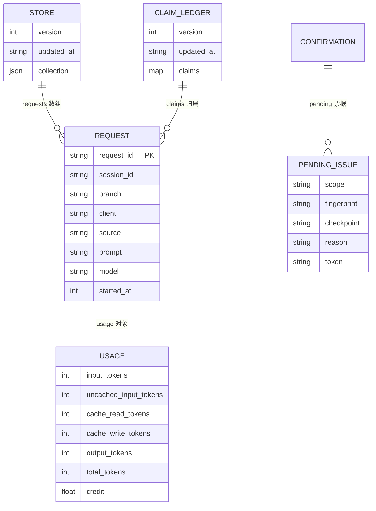

# 聚合实体：用量台账（token.json / claim ledger / 确认状态）

三个文件构成采集与门禁流程的状态面：任务内 `token.json` 是会计明细账（gitignore，禁止提交），用户主目录 `token_claims.json` 是跨任务归属账本（仓库外），`.wally/local/sop-confirmations.json` 是 SOP 确认票据（gitignore）。三者都只有 JSON 一种形态、都走「临时文件 + 原子替换」写入路径。

## 1. 实体与存储关系图

## 2. 精确字段字典（Exact Schema Dictionary）

### 2.1 `token.json`（store 顶层，契约 docstring `.claude/hooks/_token_common.py:22-45`）

| 键路径 | 类型 | 必填 / 默认值 | 约束与语义 | 定义/校验锚点 |
|---|---|---|---|---|
| `version` | `int` | `1` | 写入端固定置 1（`_token_common.py:532-535`） | `.claude/hooks/_token_common.py:533` |
| `updated_at` | `str` | `null` 起始 | ISO8601 带时区，秒精度（`_token_common.py:534`） | `.claude/hooks/_token_common.py:532-536` |
| `requests[]` | `list[dict]` | `[]` | 按 `(started_at, request_id)` 排序存储（`_token_common.py:518-524`） | `.claude/hooks/_token_common.py:519-524` |
| `requests[].request_id` | `str` | 必填 | 合并主键；客户端各异（IDE 请求 id / assistant 消息 id / `generation_id`） | `_token_common.py:492-499` |
| `requests[].client` | `str` | `codebuddy\|cursor\|codex\|claude` | 旧 CodeBuddy 记录无此键，按 `source` 推断 | `.claude/scripts/token_report.py:175-182` |
| `requests[].source` | `str` | 采集器标签 | 枚举实值：`ide_index`、`cli_jsonl`、`claude_stop` 及 codex/cursor 内部标签 | `.claude/hooks/_token_common.py:77`、`claude_token_collect.py:156` |
| `requests[].usage` | `dict` | 必填（七键） | 恒等式 `input = uncached + cache_read + cache_write`、`total = input + output`（`_token_common.py:294-360`） | `.claude/hooks/_token_common.py:352-360` |
| `requests[].started_at` | `int` | epoch 毫秒 | 报表侧 >10^10 视为毫秒（`token_report.py:127-130`） | `.claude/scripts/token_report.py:124-134` |
| `collection` | `dict` | 可选 | Codex 会话采集健康状态（sessions/sources/guardian_discovery） | `_token_common.py:527-531`、`token_report.py:368-399` |
| 顶层校验 | — | — | `strict=True` 时结构非法抛 `invalid token store` | `_token_common.py:487-489` |

### 2.2 `token_claims.json`（认领账本，`.claude/hooks/_token_common.py:556-602`）

| 键路径 | 类型 | 约束 | 定义/校验锚点 |
|---|---|---|---|
| `claims` | `map[request_id → task_dir_abs_path]` | 插入序即 LRU 序，重插保活跃；上限 `MAX_CLAIMS=5000` 超限裁剪最旧 | `.claude/hooks/_token_common.py:585-588` |
| 存储位置 | path | `~/.wally/wally-init/token_claims.json`；env `WALLY_TOKEN_CLAIMS` 可整体覆盖路径 | `_token_common.py:66-68`、`_token_common.py:551-553` |
| 作用域 | — | 仓库外存活：分支切换隐藏旧任务目录后仍能判归属 | `_token_common.py:613-636` |

### 2.3 `sop-confirmations.json`（确认票据，`.wally/scripts/sop_context.py:293-322`）

| 键路径 | 类型 | 约束 | 定义/校验锚点 |
|---|---|---|---|
| `pending` | `map[scope → issue]` | issue 五必备键 `scope/fingerprint/checkpoint/reason/token` 且 `scope` 自洽、`checkpoint ∈ {implement, deploy, it}` | `.wally/scripts/sop_context.py:300-305` |
| `approved` | `map[scope → fingerprint]` | 放行后从 pending 迁入 | `.wally/scripts/sop_context.py:361-364` |
| `token` | `str` | 12 位十六进制随机（`secrets.token_hex(6)`） | `sop_context.py:333-335` |
| `fingerprint` | `str` | SHA256(证据指纹)；证据变化即失效须重新确认 | `sop_context.py:287-289` |

## 3. 存储介质与读写归属矩阵

| 载体 | 路径 | Writers | Readers | 原子性 |
|---|---|---|---|---|
| 任务台账 | `.wally/plans/<task>/token.json`（gitignore：`.gitignore:3-4`） | `merge_store`（`_token_common.py:466-541`） | `load_requests`（`token_report.py:109-121`）、`store_request_ids`（`_token_common.py:605-610`） | flock(`store:` 锁) + 临时文件 `os.replace` |
| 认领账本 | `~/.wally/wally-init/token_claims.json` | `record_claims`（`_token_common.py:571-602`） | `load_claims`（`_token_common.py:556-569`） | flock(`claims:` 锁) + 原子替换 |
| 确认状态 | `.wally/local/sop-confirmations.json`（gitignore：`.gitignore:2`） | `save_confirmation_state`（`sop_context.py:311-322`） | `confirmation_state`（`sop_context.py:293-308`） | 临时文件 + `replace` |
| 概览报表区 | `00-overview.md` 标记对内 | `patch_overview`（`token_report.py:417-427`） | 人工/审查 | 正则单次替换 |

提交纪律：`token.json`、`sop-confirmations.json` 均在 gitignore 面内，且 `.wally/versions/3f84e7245abcc75d/commit.md:6` 明文禁止提交原始台账与凭证类临时产物。

## 4. 字段增删改共变清单（Schema Change Playbook）

- `usage` 七键增删：同步归一化输出（`_token_common.py:352-360`）、Cursor 最大值合并（`_token_common.py:383-393`）、报表合计列与表头（`token_report.py:282-290`、`token_report.py:348-352`）；恒等式两式必须继续成立否则会计口径破坏。
- 回合聚合键（`root_turn_id`/`generation_id`/`agent_kind`）调整：只影响报表 `rollup_turns`（`token_report.py:195-230`）与 [WF-04](../token-report.md) 第 3 节聚合规则表。
- `collection` 健康字段扩展：采集器写入点（`_token_common.py:527-531`）与报表 `render_health`（`token_report.py:368-399`）成对改。
- `pending` 票据结构变化：校验白名单（`sop_context.py:301-305`）、口令正则（`sop_context.py:352-354`）与 [sop-task-artifacts](sop-task-artifacts.md) 第 5 节共变链同步。
