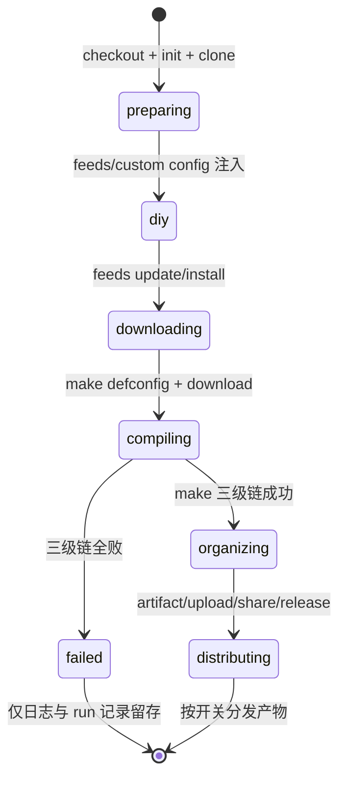

# `WF-01` · 360 V6 OpenWrt 固件云端构建与分发流程

触发条件为 `workflow_dispatch` 手动运行或 `repository_dispatch` 联动事件（来自 [WF-02](source-update-trigger.md)）；目标是产出可刷入 360 V6（IPQ60xx 平台）的 OpenWrt 固件并按五个 `UPLOAD_*` 开关分发。同步单 job 批处理形态：无中间状态存储，全部中间态位于 runner 的 `/workdir` 与 Actions 运行期环境变量。

## 1. 符号级端到端执行调用树

```text
Trigger: workflow_dispatch(ssh?) / repository_dispatch -> .github/workflows/build-openwrt.yml:36 jobs.build
  ├─ [Step 1-2 环境准备] build-openwrt.yml:41-55  checkout 本仓; apt 清理+装依赖+TZ+建 /workdir
  ├─ [Step 3 取源码]     build-openwrt.yml:57-62  git clone lede master -> openwrt; ln -sf 进工作区
  ├─ [Step 4 feeds 定制] build-openwrt.yml:64-69  [ -e feeds.conf.default ] && mv; 执行 diy-part1.sh(追加 passwall feed)
  ├─ [Step 5 feeds 拉装] build-openwrt.yml:71-75  feeds update -a; feeds install -a
  ├─ [Step 6 装配置]     build-openwrt.yml:77-83  mv .config -> openwrt/.config; 执行 diy-part2.sh(当前全注释)
  ├─ [Step 7 可调调试]   build-openwrt.yml:85-90  [if ssh] ssh2actions 开 tmate 会话
  ├─ [Step 8 下载]       build-openwrt.yml:92-99  make defconfig; make download -j8; 残包删除(<1024c)
  │    └─ 失败 -> job 失败(下载损坏包已被 rm 清除, 重跑即自愈)
  ├─ [Step 9 编译]       build-openwrt.yml:101-110 make -j(nproc) || make -j1 || make -j1 V=s
  │    ├─ 成功 -> ::set-output status=success; 提取 DEVICE_NAME/FILE_DATE 进 GITHUB_ENV
  │    └─ 三连败 -> job 失败(V=s 日志供定位)
  ├─ [Step 10 整理]      build-openwrt.yml:123-130 [if UPLOAD_FIRMWARE && !cancelled] FIRMWARE=$PWD; rm -rf packages
  ├─ [Step 11 分发]      build-openwrt.yml:116-137 artifact(bin)/artifact(firmware)
  ├─ [Step 12 外链]      build-openwrt.yml:139-155 [if 开关] transfer cow / transfer wet -> url 输出
  ├─ [Step 13 发布]      build-openwrt.yml:157-175 [if UPLOAD_RELEASE] tag+release.txt+gh-release
  └─ [Step 14 清理]      build-openwrt.yml:177-190 delete-workflow-runs + [if UPLOAD_RELEASE] delete-older-releases
```

## 2. 分阶段业务规则与分支判定表（Exact Code Rules & Thresholds）

| 阶段 | 负责步骤（`路径:行号`） | 精确布尔条件 / 阈值 | 命中分支行为 | 状态或数据副作用 |
|---|---|---|---|---|
| 环境瘦身 | `Initialization environment`（`build-openwrt.yml:44-55`） | 无条件执行 `rm -rf .../dotnet /usr/local/lib/android /opt/ghc` | 清出磁盘余量给编译 | runner 临时态 |
| feeds 覆盖 | `Load custom feeds`（`build-openwrt.yml:66`） | `[ -e $FEEDS_CONF ]`（本仓无该文件，恒假） | 跳过 `mv`，仅执行 DIY 脚本 | 无 |
| 配置覆盖 | `Load custom configuration`（`build-openwrt.yml:79-80`） | `[ -e files ]`（恒假）/ `[ -e $CONFIG_FILE ]`（恒真） | `.config` 覆盖 lede 默认 | 源码树内 `openwrt/.config` |
| 调试入口 | `SSH connection to Actions`（`build-openwrt.yml:87`） | `inputs.ssh == 'true' && != 'false'` 或 `contains(github.event.action, 'ssh')` | 开 tmate 会话；否则跳过 | 无产物 |
| 残包清理 | `Download package`（`build-openwrt.yml:98-99`） | `find dl -size -1024c`（小于 1KB 即视为损坏） | `ls -l` 记录后 `rm -f` 删除 | dl 目录净化 |
| 编译降级 | `Compile the firmware`（`build-openwrt.yml:106`） | 并行失败 → 单线程重试 → 再失败 `V=s` 详日志重试 | 三级链式 `||` 短路 | 失败时无 `status=success` 输出 |
| 机型提取 | `Compile the firmware`（`build-openwrt.yml:108-109`） | `grep '^CONFIG_TARGET.*DEVICE.*=y'` 非空（`[ -s DEVICE_NAME ]`） | 注入 `DEVICE_NAME=_<机型>`；空文件则不注入 | `GITHUB_ENV` |
| bin 上传 | `Upload bin directory`（`build-openwrt.yml:118`） | `UPLOAD_BIN_DIR == 'true'`（默认 false） | 恒跳过（存量开关） | 无 |
| 固件上传 | `Upload firmware directory`（`build-openwrt.yml:134`） | `steps.organize.outputs.status == 'success' && !cancelled()` | 上传 `OpenWrt_firmware<DEVICE><DATE>` | Actions Artifact |
| 外链上传 | cowtransfer / wetransfer（`build-openwrt.yml:141`、`build-openwrt.yml:150`） | `UPLOAD_COWTRANSFER/UPLOAD_WETRANSFER == 'true'`（默认 false） | 恒跳过；开启后 url 进 warning + 步骤输出 | Actions 注释流 / release.txt |
| Release | `Generate release tag`（`build-openwrt.yml:159`） | `UPLOAD_RELEASE == 'true'`（默认 false） | 恒跳过；开启后 tag 名 `%Y.%m.%d-%H%M` | Release + tag |
| 旧件清理 | `Remove old Releases`（`build-openwrt.yml:185`） | `UPLOAD_RELEASE == 'true' && !cancelled()` | 恒跳过（与 Release 开关绑定） | 保留最近 3 个 Release |

## 3. 流程级状态与产物语义



不变量：分发步骤全部以 `steps.compile.outputs.status == 'success'`（`build-openwrt.yml:118`）或 `steps.organize.outputs.status == 'success'`（`build-openwrt.yml:134`、`build-openwrt.yml:141`、`build-openwrt.yml:150`）为守卫——编译失败绝不产出半成品分发；唯二例外是无守卫的 `Check space usage`（`build-openwrt.yml:112-114`）与 `Delete workflow runs`（`build-openwrt.yml:177-181`），它们在任何结局都执行。

## 4. 幂等、并发与失败补偿表

| 边界 / 故障场景 | 源码检测条件（`路径:行号`） | 保护/回滚/降级动作 |
|---|---|---|
| 下载残包导致编译失败 | `find dl -size -1024c`（`build-openwrt.yml:98-99`） | 删除小于 1KB 文件；重跑工作流自愈 |
| 并行编译 OOM / 竞态 | `make -j$(nproc) \|\| make -j1 \|\| make -j1 V=s`（`build-openwrt.yml:106`） | 自动降线程直至详日志单线程重试 |
| 编译失败后产物误传 | `status == 'success'` 守卫链（`build-openwrt.yml:118`、`build-openwrt.yml:134`） | 分发步骤整体短路，无残缺固件外流 |
| 产物误含 ipk 仓库 | `rm -rf packages`（`build-openwrt.yml:128`） | 固件目录只留镜像与 factory/sysupgrade 文件 |
| 磁盘不足 | `df -hT`（`build-openwrt.yml:60`、`build-openwrt.yml:112-114`，`!cancelled()`） | 仅观测上报，无自动回收（人工经 ssh 通道清理） |
| 重复构建同 commit | 无防重机制（与 WF-02 的缓存幂等互补，`update-checker.yml:40`） | 允许人工重复构建；产物以 `FILE_DATE` 区分（`build-openwrt.yml:110`） |

## 5. 共变耦合与修改清单（Agent Co-Change Playbook）

1. 改构建输入（`.config` 目标段 / feed 追加 / DIY 脚本）：核对 [openwrt-build-pipeline](../architecture/openwrt-build-pipeline.md) 第 3 节输入契约表与 [openwrt-passwall-feed 契约](../integrations/downstream/openwrt-passwall-feed.md)。
2. 改分发开关默认值（`build-openwrt.yml:29-33`）：同步 [配置手册](../contracts/configuration.md) 环境变量表与本页第 2 节判定表。
3. 改产物命名：`DEVICE_NAME`/`FILE_DATE` 拼接点共三处（`build-openwrt.yml:120`、`build-openwrt.yml:136`、`build-openwrt.yml:161` 的 tag 格式），须一致联动否则 Artifact 与 Release 命名漂移。
4. 任何 workflow 改动属于开发 SOP 范围（`AGENTS.md:10`）：先走 [WF-03 任务流程](sop-task-lifecycle.md) 建任务再改，改动验证方式见 [构建与验证手册](../operations/dev-and-test.md)（本仓无本地单测，验证靠 Actions 冒烟运行）。
