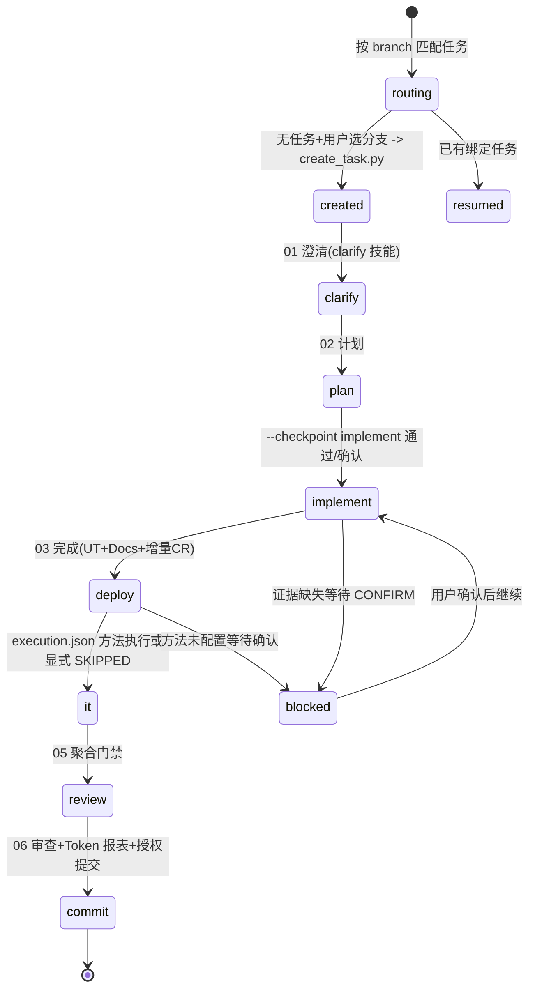

# `WF-03` · SOP 六阶段开发任务生命周期流程

本仓一切开发类改动的强制流程（咨询与纯编辑类文档工作除外，分类规则见 `.wally/core/scope.md:3-5`）：用户选定任务分支 → `create_task.py` 生成绑定规则快照的任务目录 → 六阶段推进（01 Clarify → 02 Plan → 03 Implement+UT+Docs → 04 Deploy → 05 IT → 06 Review+Commit）→ 每阶段前置 `--checkpoint` 门禁与用户确认口令 → Commit 前渲染 Token 报表。当前分支 `chore/wally-init-20261127-c48491` 尚无绑定任务（`.wally/plans` 目录不存在于当前工作树）。

## 1. 符号级端到端执行调用树

```text
Trigger: 用户提出开发请求 -> AGENTS.md 分类(scope.md) -> .wally/scripts/sop_context.py 路由
  ├─ [Phase 0 建任务] create_task.py:69 create(name, branch)
  │    ├─ [guard] 名字/分支/安装状态/同分支占用校验 (create_task.py:71-104)
  │    ├─ [scaffold] 版本模板展开 + execution.json 快照 (create_task.py:105-115)
  │    ├─ [annotate] Deploy/IT 状态注记 BLOCKED/SKIPPED/PENDING (create_task.py:117-146)
  │    └─ [atomic] 临时目录 staging 后 rename 落盘 (create_task.py:148-159)
  ├─ [Phase 1-6 推进] 每阶段: sop_context.py --checkpoint <implement|deploy|it>
  │    ├─ implement: 01/02 勾选且非空模板才放行 (sop_context.py:268-274)
  │    ├─ deploy/it: execution.json 方法已配置才放行 (sop_context.py:276-284)
  │    └─ 不满足 -> require_confirmation 落 pending+token, exit 3 等待
  │         └─ 用户回复 "CONFIRM SOP <12hex>" -> accept_confirmation 转 approved (sop_context.py:348-366)
  ├─ [Phase 3 知识维护] core/knowledge.md 政策: fileToDocs 路由更新 .wally/docs/ (.wally/versions/3f84e7245abcc75d/core/knowledge.md:17)
  ├─ [Phase 6 报表] token_report.py 渲染 token.json -> 00-overview.md 标记对内
  └─ [Phase 6 提交] commit.md 规则: 仅显式列文件 git add; 用户授权后才 commit/push
       └─ 审查基线: .wally/review.md:35-37 知识一致性核对; 流程契约: .wally/versions/3f84e7245abcc75d/core/workflow.md:54 时间记录铁律; 执行适配: .wally/profiles/project.md:20-23
```

## 2. 分阶段业务规则与分支判定表

| 阶段 | 负责机制（`路径:行号`） | 精确条件 / 阈值 | 命中行为 | 副作用 |
|---|---|---|---|---|
| 请求分类 | `scope.md`（`.wally/core/scope.md:3-5`） | 特征实现/修 bug/重构/性能/行为/配置/脚本/规则/技能改动 = 开发 | 进 SOP；咨询/只读/纯文档编辑直接处理 | 无 |
| 建任务准入 | `create`（`.wally/scripts/create_task.py:71-74`） | 名字 `\d{4}-\d{2}-\d{2}_[\w.-]+` 且不以 `.` 结尾；分支非 `main/master/HEAD` 且无 `|` `` ` `` 换行 | 违规即 `ValueError` 退出 | 无 |
| 安装状态门槛 | `create`（`create_task.py:83-90`） | `schema==2 && steps==6 && revision` 16 位十六进制且 `translation_sources` 为空 | 违规拒绝建任务 | 无 |
| 分支独占 | 分支占用扫描（`create_task.py:98-104`） | 其他任务概览 Branch 字段与目标分支相同 | 拒绝：`branch already belongs to task` | 无 |
| Deploy/IT 初始态 | 状态注记（`create_task.py:120`） | `readiness: pending` → `BLOCKED`；有 command/guide → `PENDING`；都没有 → `SKIPPED`（记决策时间） | 概览勾选项与时间表预填 | `00-overview.md` |
| Implement 门禁 | `checkpoint_issue`（`.wally/scripts/sop_context.py:268-274`） | 01/02 概览勾选 `[x]` 且对应文件 ≠ 模板原文 | 不满足 → 确认流 | `sop-confirmations.json` |
| Deploy/IT 门禁 | `checkpoint_issue`（`sop_context.py:276-284`） | `method_configured(method)` 为真（readiness≠pending 且 command/guide 非空） | 不满足 → 确认流 | 同上 |
| 确认放行 | `accept_confirmation`（`sop_context.py:352-366`） | 口令 `CONFIRM SOP <token>` 与 pending 记录指纹一致 | 转 approved，允许继续（不等于通过） | 确认状态文件 |
| 编辑拦截 | `check_tool`（`sop_context.py:369-391`） | 编辑类工具 + 路径在任务目录外 + 非被动文档（`plain_document`，`sop_context.py:210-256`） | Hook 返回 deny；否则放行 | 无 |
| 知识验证 | `core/knowledge.md`（`.wally/versions/3f84e7245abcc75d/core/knowledge.md:17-20`） | 任务 diff 与 `.wiki-meta.json` 映射对账 | Docs 缺口未解决不得标记通过 | `.wally/docs/` 页面 |

## 3. 任务生命周期状态机



铁律：`SKIPPED is not passed`（`AGENTS.md:48`）——自动跳过的 Deploy/IT 必须在 Review 中披露缺失验证；确认口令只允许「带缺口继续」，禁止把未验证工作记为通过（`sop_context.py:365`）。

## 4. 幂等、并发与补偿回滚表

| 场景 | 检测/机制（`路径:行号`） | 动作 |
|---|---|---|
| 任务目录已存在 | `task.exists()`（`create_task.py:96-97`） | 拒绝创建；staging 期间被抢占同样报错（`create_task.py:157-158`） |
| 建任务中途失败 | 临时目录 + `rename`（`create_task.py:148-159`） | 失败即丢弃 staging，不留半成品目录 |
| 确认状态并发写 | 临时文件 + `replace`（`sop_context.py:311-322`） | 原子替换；指纹不匹配视为过期（`sop_context.py:361-366`） |
| 多任务命中同分支 | `len(matches) != 1`（`sop_context.py:105-107`） | 拒绝路由，要求先消歧 |
| 阶段文件与编号错位 | 文件名前缀校验（`sop_context.py:137-143`） | 拒绝并要求先修概览 |
| 旧版任务恢复 | compat/v1 快照（`sop_context.py:116-129`） | 快照缺失 → 阻断（禁止隐式迁移到新规则） |

## 5. 共变耦合与修改清单（Agent Co-Change Playbook）

1. 改任务工件结构（模板 / 阶段文件名 / 概览字段）：联动 [sop-task-artifacts 领域模型](domain-models/sop-task-artifacts.md) 第 2 节字段字典与 [sop-engine-and-routing 组件](../architecture/sop-engine-and-routing.md) 第 4 节共变清单（`FILENAMES` 映射与三正则四处同步）。
2. 改执行方法配置（`.wally/config.json` 的 deploy/it 段）：新建任务才会快照生效（`create_task.py:114-115`）；已存在任务的 `execution.json` 需单独核对（`sop_context.py:276`）。
3. 改确认口令或流程话术：`sop_context.py:341-345`、`AGENTS.md:52`、[agent-integration-layer](../architecture/agent-integration-layer.md) Hook 输出协议三处同改。
4. 流程规则本体（workflow/gates/interaction）改动即规则版本升级：不得原地改 `.wally/versions/3f84e7245abcc75d/`（`install-state.json:27-52` 的 `managed_files` 哈希会漂移），应走 wally-init 升级路径；同时 `install-state.json:4` 的 `revision` 决定任务绑定目录名。
5. 提交阶段约束：`token.json` 原始文件禁止提交（`.gitignore:3-4`、`.wally/versions/3f84e7245abcc75d/commit.md:6`）；Token 报表渲染流程见 [WF-04](token-report.md)。
