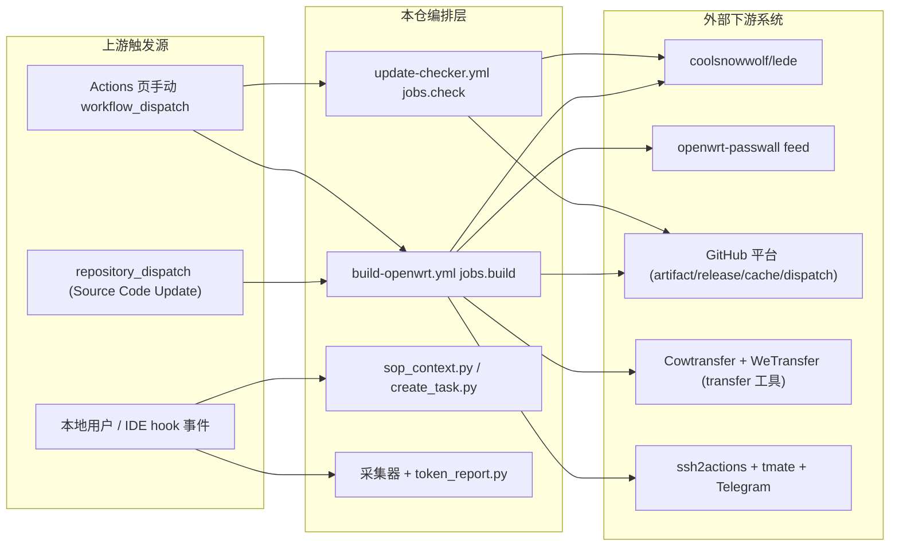

# 上下游集成与调用拓扑总览

汇总本仓全部「上游被谁调 ↔ 下游调了谁」双向拓扑。上游触发源两类（人工/事件触发的工作流、本地用户与 IDE hook）；下游外部系统六个，各自有独立出向契约页。本仓无 HTTP 服务与数据库，全部出向调用经 git clone、marketplace Action `uses:`、shell 工具与技能文档约定发生。

## 1. 上下游调用拓扑图（Inbound ↔ Internal ↔ Outbound）

## 2. 仓内组件「上游有谁 ↔ 下游调谁」双向速查表

| 本仓组件 / 模块 | 源码路径 | 直接上游调用方（`路径:行号`） | 调用的仓内下游模块 | 调用的外部下游封装 | 组件架构页 |
|---|---|---|---|---|---|
| `jobs.build` | `.github/workflows/build-openwrt.yml:37-190` | `workflow_dispatch`/`repository_dispatch`（`build-openwrt.yml:14-20`） | DIY 脚本与 `.config` 注入（`build-openwrt.yml:64-83`） | [lede](downstream/coolsnowwolf-lede.md)、[passwall feed](downstream/openwrt-passwall-feed.md)、[GitHub 平台](downstream/github-actions-platform.md)、[transfer](downstream/file-transfer.md)、[ssh2actions](downstream/ssh2actions-debug.md) | [`openwrt-build-pipeline`](../architecture/openwrt-build-pipeline.md) |
| `jobs.check` | `.github/workflows/update-checker.yml:24-58` | 手动 `workflow_dispatch`（`update-checker.yml:19`；cron 注释态） | — | [lede](downstream/coolsnowwolf-lede.md)、[GitHub 缓存/派发](downstream/github-actions-platform.md) | [`update-checker`](../architecture/update-checker.md) |
| `sop_context.py` / `create_task.py` | `.wally/scripts/sop_context.py`、`.wally/scripts/create_task.py` | 四客户端 hook 注册（`.claude/settings.json:18` 等）与 CLI 用户 | `method_configured` import（`sop_context.py:8`）、规则文档包 | wally-open-cli 服务（仅技能约定，无代码调用） | [`sop-engine-and-routing`](../architecture/sop-engine-and-routing.md)（入口符号 `route`（`sop_context.py:87`）/`create`（`create_task.py:69`）） |
| 采集器/报表 | 四客户端 `hooks/`、`scripts/` | hook 事件（`.codebuddy/settings.json:3-13` 等） | `_token_common.py` 底座 | — | [`token-collectors`](../architecture/token-collectors.md) |
| 技能三件套 | `.agents/skills/*/SKILL.md` | 六客户端 skills 软链 + AGENTS 阶段表（`AGENTS.md:24`） | — | wally-open-cli 服务（`.agents/skills/wally-open-cli/SKILL.md:20` 的 `api_base_url` 约定） | [`agent-integration-layer`](../architecture/agent-integration-layer.md) |

## 3. 外部下游依赖系统全量清单（Downstream Registry）

| 下游系统名 | 承担业务职责 | 协议与成功判定 | 底层传输机制 | 本仓封装/引用位置 | 出向字典契约专页 |
|---|---|---|---|---|---|
| `coolsnowwolf/lede` | OpenWrt 源码供给 | git（clone 退出码 0） | `git clone`（全量/`--depth 1`） | `build-openwrt.yml:61`、`update-checker.yml:32` | [`downstream/coolsnowwolf-lede.md`](downstream/coolsnowwolf-lede.md) |
| `openwrt-passwall` | 扩展软件源 | feed 声明行 + `scripts/feeds` 退出码 | `src-git` 追加进 `feeds.conf.default` | `diy-part1.sh:18` | [`downstream/openwrt-passwall-feed.md`](downstream/openwrt-passwall-feed.md) |
| `GitHub Actions 平台` | runner 宿主 / Artifact / Release / 缓存 / 派发 / 清理 | 各 Action 退出码；`cache-hit` 输出 | marketplace `uses:` + secrets | `build-openwrt.yml:116-190`、`update-checker.yml:35-58` | [`downstream/github-actions-platform.md`](downstream/github-actions-platform.md) |
| `Cowtransfer / WeTransfer` | 固件外链分发 | 日志含 https 行即成功 | `transfer cow/wet` CLI（`git.io/file-transfer` 安装） | `build-openwrt.yml:139-155` | [`downstream/file-transfer.md`](downstream/file-transfer.md) |
| `ssh2actions + tmate + Telegram` | 构建期 SSH 调试与通知 | 条件触发即启用；通知尽力而为 | `P3TERX/ssh2actions@v1.0.0` + secrets | `build-openwrt.yml:85-90` | [`downstream/ssh2actions-debug.md`](downstream/ssh2actions-debug.md) |
| `wally-open-cli 托管服务` | 任务委托托管（仅技能约定） | `curl <api_base_url>/ok` 返回 `"ok": true`（技能文档字面） | `@tencent/wally-open-cli` npm 包（仓内无调用代码） | `.agents/skills/wally-open-cli/SKILL.md` | 无代码封装层：契约仅技能文档约定（[认知边界](../operations/boundary.md) 第 2 节） |

字段级映射（上游输入 → 下游参数键）见 [`topology-and-mapping.md`](topology-and-mapping.md)。
