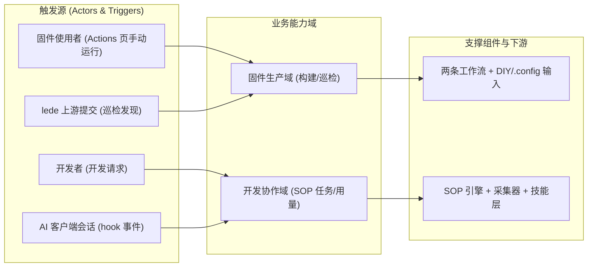

# 业务架构全景

本仓服务两类角色：固件使用者（获得 360 V6 路由器的自定义 OpenWrt 固件）与仓库开发者（在六阶段 SOP 约束下演进本仓）。业务能力域分两个——「固件生产域」（两条工作流）与「开发协作域」（SOP 任务流程 + 用量核算），端到端闭环：上游 lede 更新 → 自动触发构建 → 产物分发；开发改动 → 任务绑定 → 门禁确认 → 提交。

## 1. 角色触发源与业务域拓扑

## 2. 业务域边界与能力矩阵

| 业务域标识 | 业务域名称 | 核心业务职责 | 核心状态实体 | 归属代码模块 | 核心准入/配额约束 | 关联业务清单 |
|---|---|---|---|---|---|---|
| `DOM-01` | 固件生产 | 从 lede 源码产出 360 V6（IPQ60xx）定制固件并分发 | Actions run、Artifact、Release、`DEVICE_NAME`/`FILE_DATE`（运行期） | `.github/workflows/build-openwrt.yml`、`diy-part*.sh`、`.config` | Actions 仓库权限；`UPLOAD_*` 开关矩阵；runner 磁盘 | [业务总表](../business/index.md) |
| `DOM-02` | 开发协作 | SOP 任务全生命周期管理与模型用量核算 | `00-overview.md`、`execution.json`、`token.json`、确认票据 | `.wally/scripts/`、`.wally/versions/`、四客户端 hooks | 六阶段门禁 + 确认口令；分支黑名单；`readiness` 配置 | [业务总表](../business/index.md) |

## 3. 全量业务流程主索引（`WF-*`）

| 流程 ID | 流程名称 | 触发入口（`路径:行号`） | 串联组件与下游（按执行序） | 关键状态迁移 | 流程专页 |
|---|---|---|---|---|---|
| `WF-01` | 固件云端构建与分发 | `workflow_dispatch`/`repository_dispatch`（`.github/workflows/build-openwrt.yml:14-20`） | build job → lede → feeds(passwall) → buildroot → Artifact/Release/transfer | 下载→编译→整理→分发（失败即终止分发） | [`business/firmware-build.md`](../business/firmware-build.md) |
| `WF-02` | 上游更新检测与联动触发 | `workflow_dispatch`（`.github/workflows/update-checker.yml:19`） | check job → lede 浅克隆 → cache 比对 → dispatch 派发 → WF-01 | 新哈希→派发（缓存幂等） | [`business/source-update-trigger.md`](../business/source-update-trigger.md) |
| `WF-03` | SOP 六阶段任务生命周期 | 开发请求分类（`AGENTS.md:8-12`）→ `create_task.py`（`.wally/scripts/create_task.py:164`）/ `sop_context.py`（`.wally/scripts/sop_context.py:394`） | 建任务 → 六阶段推进 → 门禁/确认（执行方法实况见 `.wally/config.json:8-24` 的 `readiness`/`gaps`）→ 报表 → 授权提交 | 建任务→blocked(待确认)→commit | [`business/sop-task-lifecycle.md`](../business/sop-task-lifecycle.md) |
| `WF-04` | 用量采集与报表 | IDE hook 事件（`.claude/settings.json:3-13` 等）→ Commit 前人工报表 | 采集器 → 台账合并 → 回合聚合 → 概览渲染 | 事件→增量合并→快照渲染 | [`business/token-report.md`](../business/token-report.md) |

## 4. 全局业务不变量（不可破坏的业务红线）

1. **产物完整性不变量**：编译未成功（`status != 'success'`）绝不分发固件——守卫链 `.github/workflows/build-openwrt.yml:118`、`build-openwrt.yml:134`；清理步骤（`build-openwrt.yml:177-181`）是唯二无条件步骤之一。
2. **触发幂等不变量**：同一上游提交至多自动派发一次构建——缓存键 `HEAD-<hash>`（`update-checker.yml:40`）+ 未命中守卫（`update-checker.yml:43`、`update-checker.yml:48`）。
3. **规则不可变不变量**：任务执行期间绑定规则版本不得替换、不得回退最新版——校验 `.wally/scripts/sop_context.py:130-132`；legacy 任务须快照（`sop_context.py:116-129`）。
4. **确认诚实不变量**：用户确认只允许「带缺口继续」，禁止把 SKIPPED/未验证记为通过——`sop_context.py:365`、`AGENTS.md:48`。
5. **台账纪律不变量**：原始 `token.json` 与确认票据不提交；用量快照声明「缺失不等于零」——`.gitignore:2-4`、`.claude/scripts/token_report.py:397`。
6. **凭据边界不变量**：secret 只经 GitHub 配置面注入，仓内仅引用点——`.github/workflows/build-openwrt.yml:89-90`、`build-openwrt.yml:171`、`update-checker.yml:51`。
