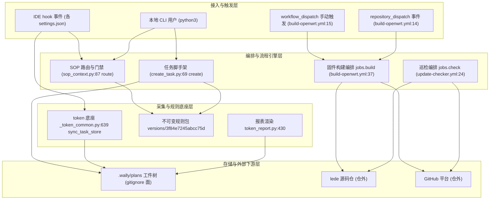

# 系统技术架构

本仓是「无驻留进程」的双形态系统：线上侧两条 GitHub Actions 工作流（固件构建 + 上游巡检）构成事件驱动批处理管线；本地侧 SOP 工具链（两个 stdlib-only Python CLI + 四客户端 hook 采集器）构成开发协作运行时。核心隔离原则：构建态全部存在于 runner 临时磁盘，SOP 态全部存在于文件系统工件（概览/台账/确认票据），两态零数据库、零共享内存。

## 1. 运行时分层与依赖拓扑



| 架构层 | 包含目录 / 文件 | 核心职责 | 越界禁令（Agent 修改红线） |
|---|---|---|---|
| 接入与触发层 | `.github/workflows/build-openwrt.yml:14-20` 与 `.github/workflows/update-checker.yml:18-21` 触发段、各客户端 settings/hooks.json | 事件/命令进入系统：手动、派发、hook、CLI 四入口 | hook 注册改动必须保持宿主 `timeout: 3` > 采集自杀 2.5s（`.claude/hooks/_token_common.py:81`） |
| 编排层 | `jobs.build`、`jobs.check`、`sop_context.py`、`create_task.py` | 步骤编排、分支路由、阶段门禁、任务脚手架 | 禁止把 SOP 门禁逻辑移进 hook 之外的通用 shell（`sop_context.py:1-6` 自述非沙箱） |
| 底座层 | `_token_common.py`、`versions/`、`token_report.py` | 锁/账本/归一化内核、不可变规则模板、报表渲染 | 禁止原地改 `versions/`（`sop_context.py:130-132` 校验禁回退）；`_token_common.py` 保持 stdlib-only（`_token_common.py:12-15`） |
| 存储与外部层 | `.wally/plans/`、`.wally/local/`、`~/.wally/wally-init/`、lede、GitHub 平台 | 工件持久化、确认票据、认领账本、源码与产物服务 | 凭据只经 secrets/env 注入；`token.json`、`sop-confirmations.json` 永不提交（`.gitignore:2-4`） |

两条业务线的静态输入资产：固件生产线的 `.config`（目标段 `.config:41-64`）与 `diy-part1.sh:18`（feed 注入）；开发协作线的协作入口正本 `AGENTS.md:1-4`（`CLAUDE.md`/`CODEBUDDY.md` 为其软链）。

## 2. 启动装配与停机序列（Bootstrap Call Tree）

本仓无常驻进程启动序列；两段「等价启动」如下：

```text
CI 侧装配: workflow 触发 -> .github/workflows/build-openwrt.yml:36 jobs.build
  ├─ [1. checkout]   build-openwrt.yml:41-42  actions/checkout -> $GITHUB_WORKSPACE
  ├─ [2. runtime]    build-openwrt.yml:44-55  apt 依赖 + TZ + /workdir 建目录授权
  ├─ [3. source]     build-openwrt.yml:57-62  clone lede + ln -sf 软链桥
  └─ [4. teardown]   build-openwrt.yml:177-190 删 run/旧 Release(runner 随 job 回收)

本地侧装配: 用户/IDE 事件 -> 脚本进程
  ├─ [1. locate]     _token_common.py:210-220 find_repo 向上找 .wally
  ├─ [2. branch]     _token_common.py:237-255 git_branch(1s 超时)
  ├─ [3. bind]       _token_common.py:258-291 find_task_dir 概览 Branch 字段匹配
  └─ [4. shutdown]   _token_common.py:126-131 SIGALRM 2.5s 强制退出(原子写由临时文件保证)
```

## 3. 跨切面工程机制速查表

| 机制维度 | 核心符号与源码锚点 | 全局实现规则 |
|---|---|---|
| 任务鉴权与归属 | `route`（`.wally/scripts/sop_context.py:87-115`） | 分支文本绑定任务；多任务/零任务均拒绝继续；无用户体系（信任本地执行者） |
| 并发与锁 | `file_lock`（`.claude/hooks/_token_common.py:396-441`） | 全部写路径走 timed flock（0.4s 超时放弃 + 下次重试）；无长锁、无队列 |
| 状态一致性 | `merge_store`（`_token_common.py:466-541`） | `request_id` 键控合并 + 排序 + 临时文件 `os.replace` 原子替换；建任务走 staging+rename（`create_task.py:148-159`） |
| 异常到退出码映射 | `main`（`sop_context.py:394-462`） | 交互态 `exit 1`（错误）/`exit 3`（待确认）；hook 态吞异常输出 `{}`；全表见 [错误码字典](../contracts/error-codes.md) |
| 版本与快照隔离 | `revision`（`.wally/install-state.json:4`）+ `managed_files`（`install-state.json:27-52`） | 规则演进 = 新 revision 目录；任务按概览字段钉版本；安装账本哈希由 wally-init 对账 |
| 外部边界与降级 | 采集器黑名单（`_token_common.py:223-234`）、hook 静默（`sop_context.py:466-472`）、构建三级降级（`build-openwrt.yml:106`） | 失败永不放大：采集放弃即重试、hook 失败不阻断、编译降线程重试；详见 [上下游总览](../integrations/index.md) 与 [排障 Runbook](../operations/runbook-and-observability.md) |
